# Incredible.dev

Developer content made from the material you already have. Bring a repository, docs, a blog post,
a talk or your notes, and a team of AI agents researches it, storyboards it and makes the film, the
thumbnails, the cards and the posts, in channels you can steer and on a canvas you can review. For
longer explainers, an episode takes your notes to a presenter-led film you record yourself, made
chapter by chapter in a studio of its own.

<p align="center">
  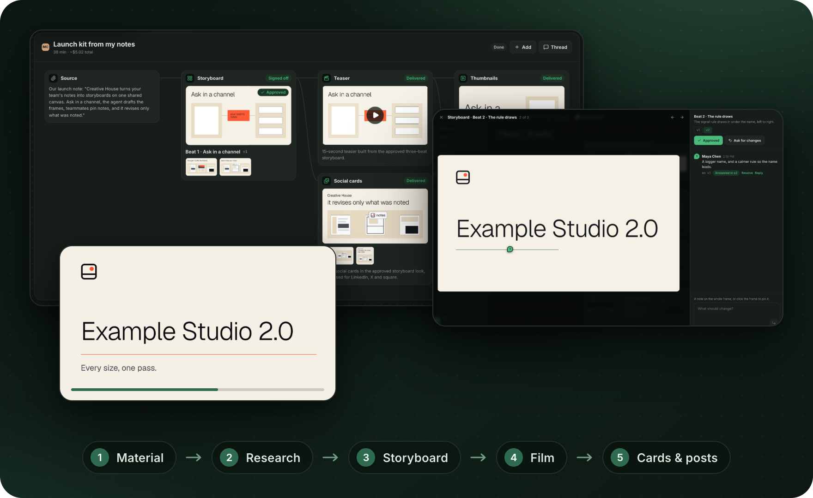
</p>

> **0.1.0 is out.** Episodes, the studio, live agent trails and the production board. Read the
> [release notes](docs/releases/0.1.0.md).
>
> **A new beginning.** This is the new Incredible.dev. The earlier video creator lives on the
> [`archive/dev-video-creator`](https://github.com/IncredibleDevHQ/Incredible.dev/tree/archive/dev-video-creator)
> branch.

**Contents:** [How it flows](#how-it-flows) · [Episodes](#episodes) ·
[The production board](#the-production-board) · [Agents on your computer](#agents-on-your-computer) ·
[Your brand](#your-brand-on-everything) · [Get started](#get-started) · [How it's built](#how-its-built)

## How it flows

### 1. Start from your material

Ask in a channel and attach what you have, or place a template: Launch kit, Explainer, Post to
social, Ad set, Pitch pack, Social pack or Talk to clips.

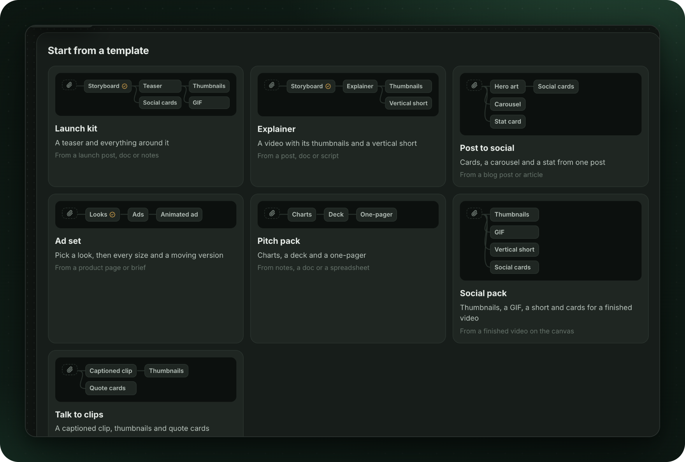

### 2. Research your code

A research frame asks local coding agents (Claude Code, Codex, Kimi Code) about your repository.
Keep any passage of an answer as a note: each note records where it came from, and notes feed what
gets made, an episode included.

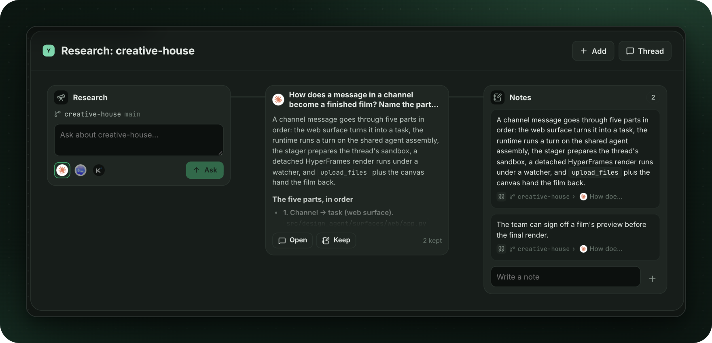

### 3. Storyboard, then sign off

Films start as a storyboard. Pin a note to a frame and the next version answers it; approve when
it's right.

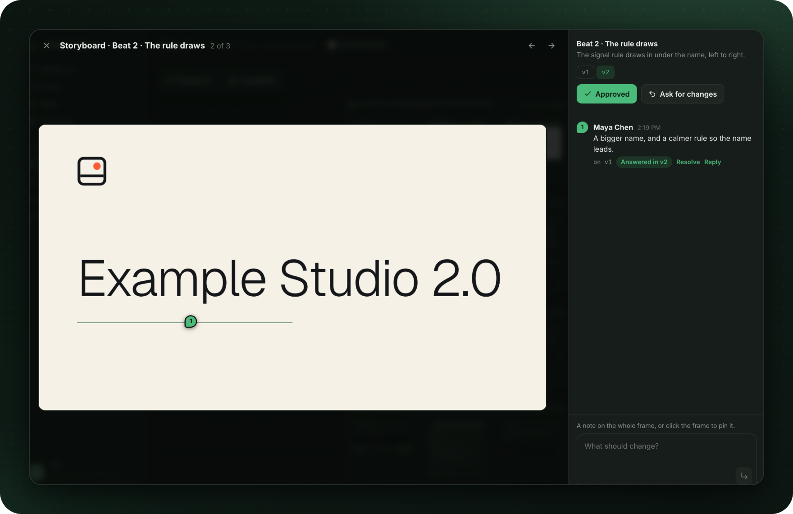

### 4. The film and everything around it

The film is built in code with [HyperFrames](https://hyperframes.heygen.com), then thumbnails,
social cards and GIFs, each linked on the canvas to what it was made from. Every channel, canvas
and card has its own address, so a link takes a teammate straight to it.

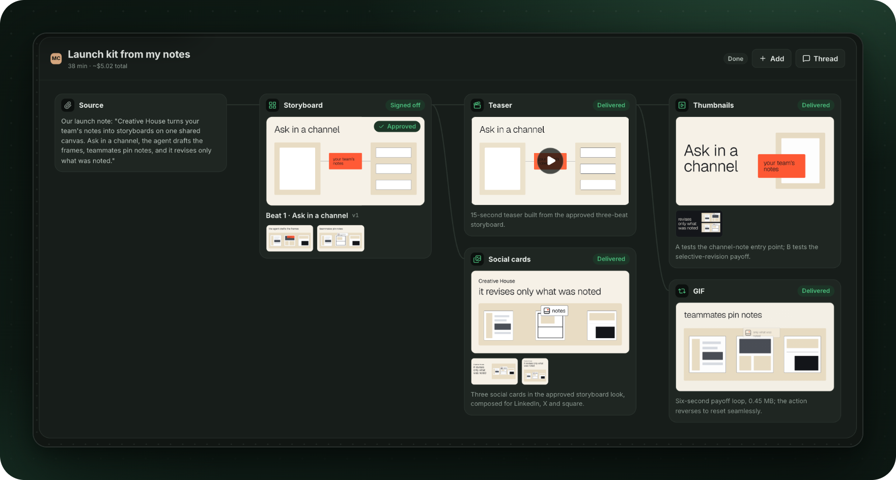

### 5. Steer it in a thread

Every task is a thread with its own lead agent and computer. Reply to steer the work, approve a
preview, or stop it.

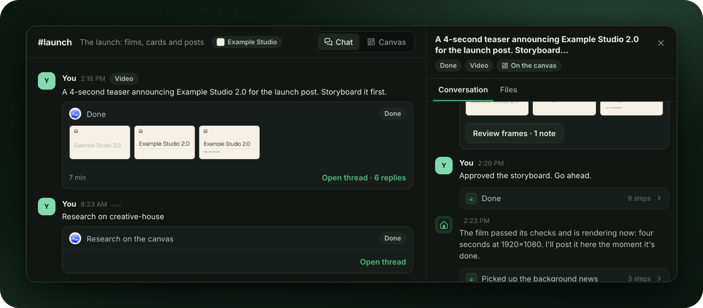

## Episodes

An episode is a presenter-led explainer of one idea, a few minutes long: you on camera,
pictures beside you, a chapter for each question the viewer would ask. Start one from your notes or
a research frame, pick who writes it and how long it should run, and take it from plan to rendered
film in one studio.

### A plan, written in stages

The agent you pick writes the plan in stages: the brief (the one idea and who it is for), the
script (chapters, each answering one question, and their beats), and a frame for every line. After
each stage, code holds the words to the checks (length, pace, what each picture needs) and the
report opens the writer's next turn. While it writes you see its steps, its own words and, between
them, what its model is thinking. You approve the plan once.

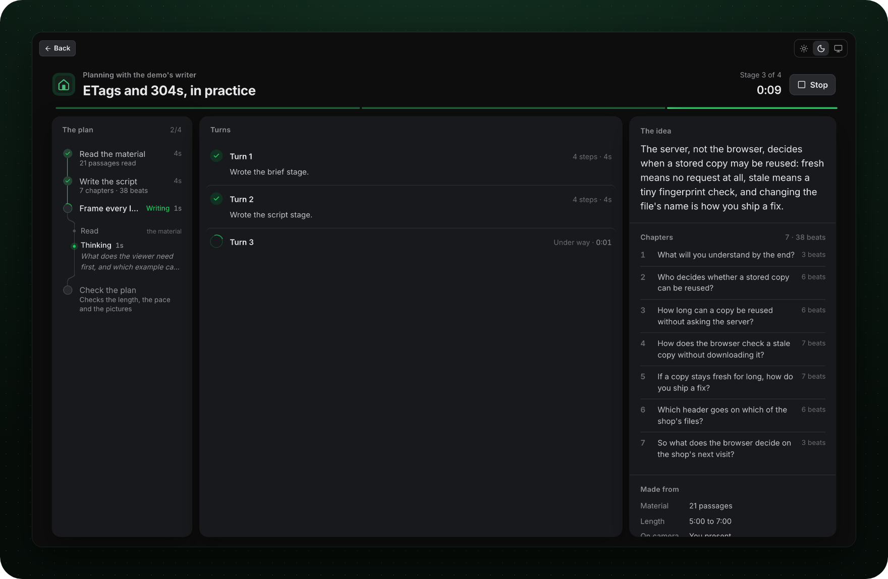

### The studio, chapter by chapter

Each chapter is a document you edit as text, a block for each picture and each run said to camera,
with the frame for the line you are on beside it and the chapter's timeline underneath. A picture's
card says which beats it plays over (one picture is drawn once and stays up while each of those
lines is said), what kind it is and how it is made. Ask AI from any line, selection, picture or
chapter; every change is marked word by word and can be taken back. Picks (a layout, a kind of
picture, an agent) are free to try: nothing runs until you press Apply changes.

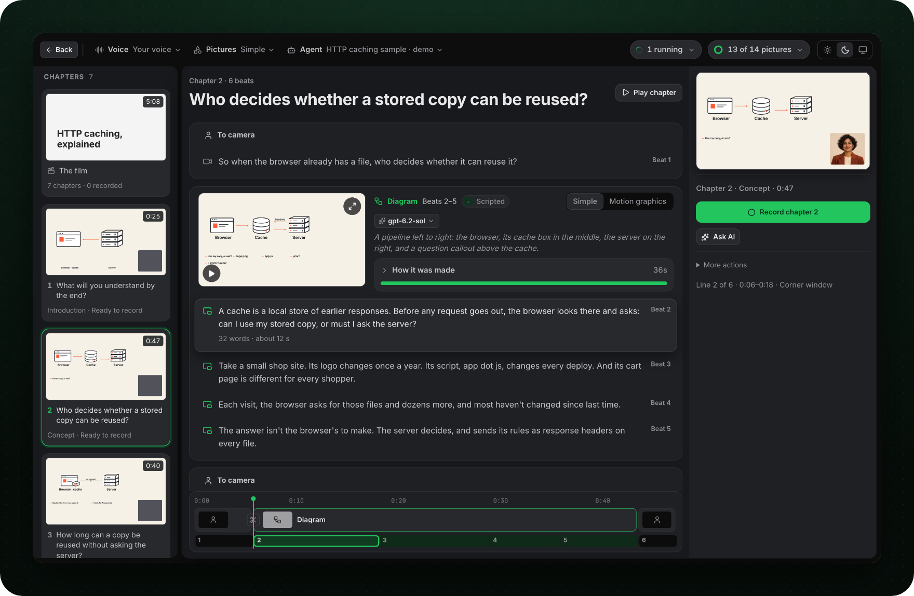

### Pictures, made by the agent you pick

Each picture is a [HyperFrames](https://hyperframes.heygen.com) composition in your brand, built by
a coding agent:

- **Simple** pictures are drawn at once from the plan. **Motion graphics** are planned first, a
  shot for each line, then drawn, then looked over by their builder, and wait for your go on a still
  of each line.
- **Any agent, any model.** Pick the agent for the film, a chapter or one beat, and the model and
  effort it runs on. Every made picture records the agent, model and effort that made it.
- **Watch it work.** The trail shows each stage with its time, each step the agent takes, and what
  its model is doing between steps: thinking (with the newest words of its thought), or writing a
  file (with how much so far). The marks move only while the agent is heard from, and a turn that
  goes silent too long says so in amber, with Stop beside it.
- **Steer without stopping.** Leave a note for a motion-graphics picture's builder; it goes in at
  its next turn.
- **Nothing is lost.** A beat keeps its last twelve versions. The History tab shows them, Use this
  version puts one back, and a redo that fails or is stopped falls back to the version before. A
  redo never blocks the studio: the frame keeps playing the version it has.

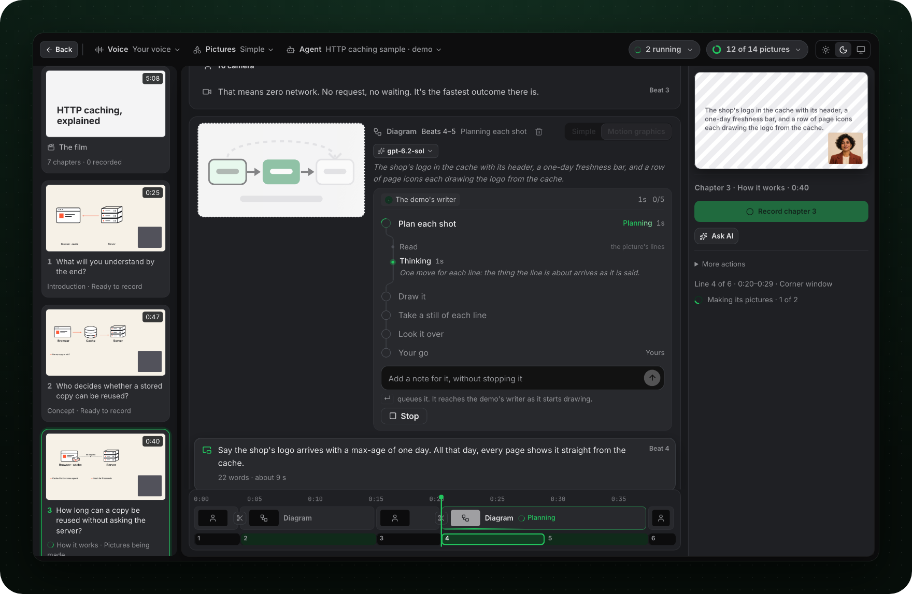

### Record, then render

Record each chapter in the browser with a reading guide (or bring a camera's file). Where each line
starts in your take sets how long it runs and when its picture's moves land, so the pictures follow
how you said it, never the other way round. Name your takes, review one before saving it, and pick
which take the film uses. The lines no take covers can be narrated in a voice you pick or a clone
of your own (with an ElevenLabs key). The film is one HyperFrames page written by code and rendered
on the thread's computer; it renders as a draft with a stand-in before anything is recorded.

## The production board

With several episodes under way, the production board is the one place to run them all. **To
make** holds what is written and not made yet, grouped by episode and chapter. **Agents** shows each
agent with what it is running and what waits its turn. **Needs you** gathers every go on stills,
every plan to read and every job that stopped. **Done** is what is made.

- **Hand work over** by dragging a job, a chapter or a whole episode onto an agent (the agent's row
  says what that comes to before you let go), with the agent's number key, or from the job's own
  details. A model and effort picked on an agent's row go with what you hand it.
- **Narrow it** to one episode, one of its chapters, or one agent; the board's address keeps the
  filter, so a link opens it the same way.
- **Look without leaving.** Open a job and its episode comes up in a sheet over the board, on that
  job's chapter and line; Escape goes back. Open full page goes to the episode itself, and the
  studio's address names the chapter and line it is on.

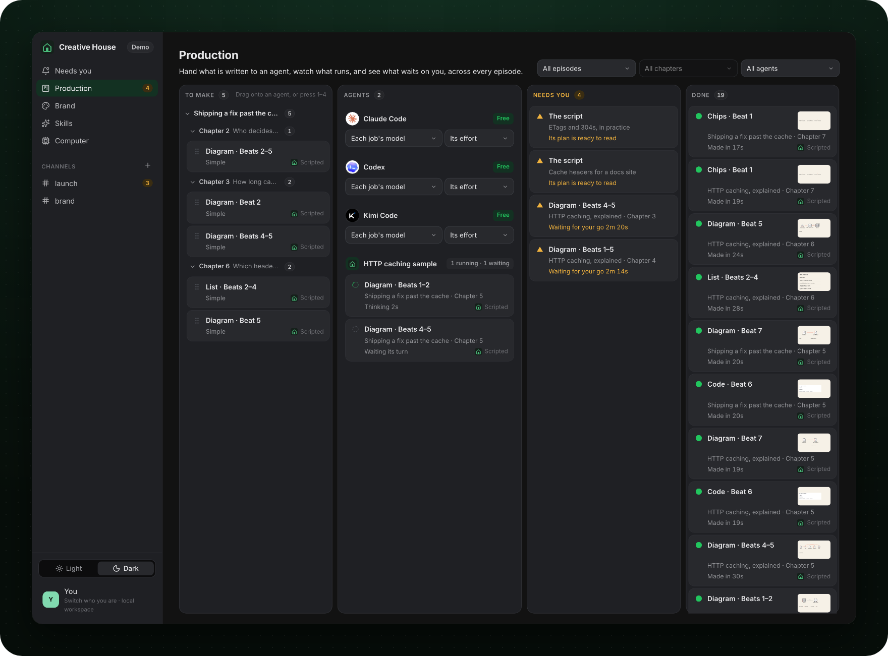

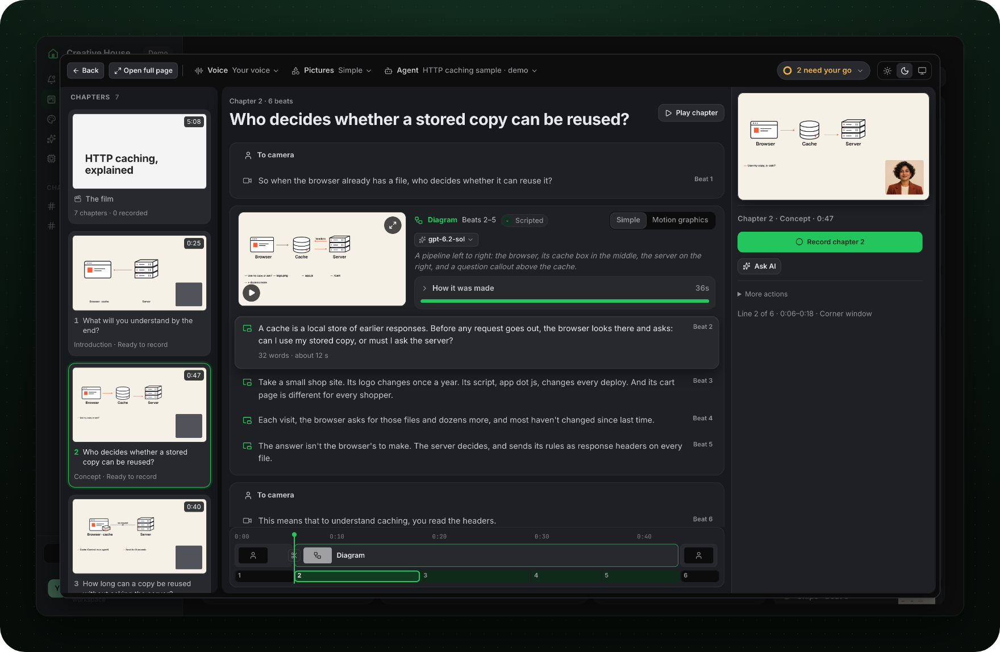

## Agents on your computer

Research and episodes use the coding agents you already have, signed in as you, on your own plan.
They get none of the app's keys.

| Agent | Research | Writes an episode | Says what it is doing |
| --- | --- | --- | --- |
| Claude Code | read-only, in plan mode | in the episode's own folder, files only (no shell, no web) | every few seconds, with summaries of its thinking |
| Codex | read-only sandbox | in the episode's own folder | at each finished step |
| Kimi Code | read-only profile | in the episode's own folder | at each finished step |
| The built-in agent | | on the episode's thread and its computer | at each step |

Each agent builds a few pictures at a time, and at most four at once across all your episodes, so
handing many to one agent queues them rather than starting them all.

## Your brand on everything

Create a brand from a website, or keep a brand pack, and choose which one each channel uses. Its
colours and type reach every card, picture and film.

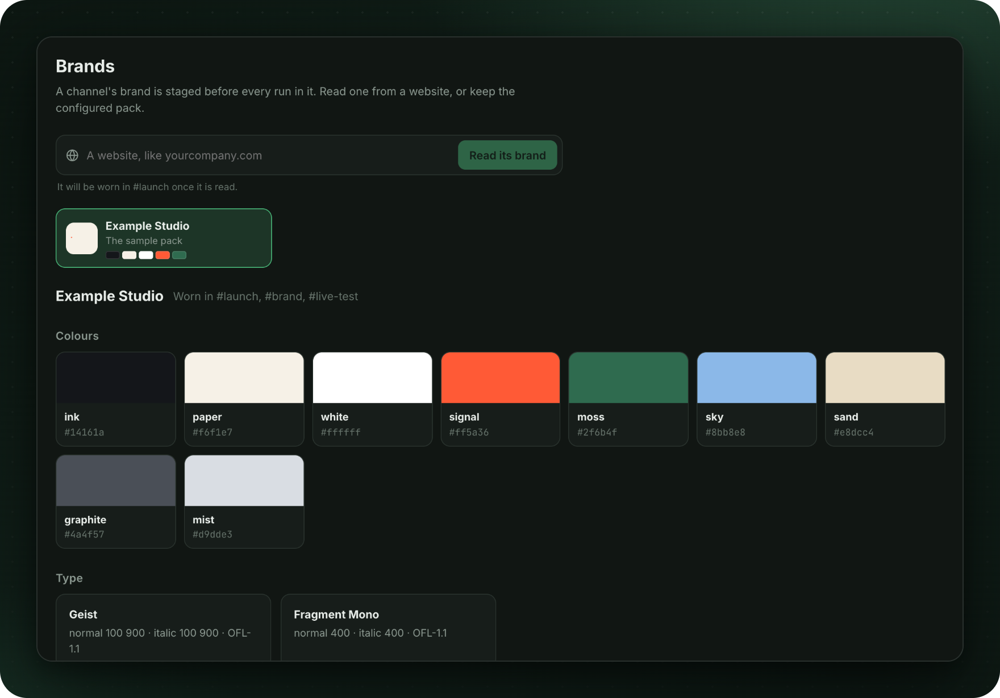

## Get started

You need Docker, [uv](https://docs.astral.sh/uv/) and Node.js.

```bash
uv sync --all-extras --dev
uv run design-agent sandbox build                    # the agents' computer
(cd web && npm install && npm run build)             # the app
uv run python -m design_agent.surfaces.web --demo    # a scripted lead, no API keys
uv run python -m design_agent.surfaces.web           # a real model (a provider key in .env)
```

Then open http://127.0.0.1:8765. In the demo, an episode can use a scripted writer and builder (a
sample about HTTP caching), so you can try the studio and the board without keys or agents. For
app development, run `npm run dev` in `web/` (port 5178); it passes `/api` through to the server.

Optional settings in `.env` (see [`.env.example`](.env.example)):

| Setting | Turns on |
| --- | --- |
| a provider key | the lead agent and the built-in writer ([Models](docs/models.md)) |
| `TYPESAFE_API_KEY` | a typed classifier that reads each stage of an episode's plan (otherwise the writer's own model does) |
| `ELEVENLABS_API_KEY` | narration and voice clones for lines no take covers |
| `DESIGN_AGENT_FOOTAGE_BUCKET` | every recording kept as it arrived, in S3 or MinIO |

The app has no sign-in yet. It serves 127.0.0.1 only and takes the person from a request header,
so don't expose it on a network.

## How it's built

- **The agents.** Each task gets a lead agent that plans and hands work to helper agents, a Docker
  sandbox of its own, skills for each kind of work, and checks it runs on its renders (brand,
  motion, output). A cost meter tracks every run, and every run of a coding agent is kept with its
  steps.
- **Episodes.** The plan's stages, checks and pictures live in `src/design_agent/episode/` and the
  `episode` skill; the studio's desk in `src/design_agent/surfaces/web/episode_desk.py`. Pictures
  and films are HyperFrames compositions, rendered on the thread's computer.
- **The app.** The server in `src/design_agent/surfaces/web/` (API, live events, store, canvas
  tools, research, episodes, brands) and the web app in `web/` (React, Vite, TypeScript), plugged in
  through one presenter hook, `src/design_agent/surfaces/presenter.py`.

More: [architecture](docs/architecture/README.md) · [product spec](docs/spec.md) ·
[instructions.md](instructions.md) · [skills/](skills/) · [customization](docs/customization.md) ·
[changelog](CHANGELOG.md) · [release notes](docs/releases/0.1.0.md).

## License

[Apache 2.0](LICENSE). Third-party notices are in [NOTICE.md](NOTICE.md).
