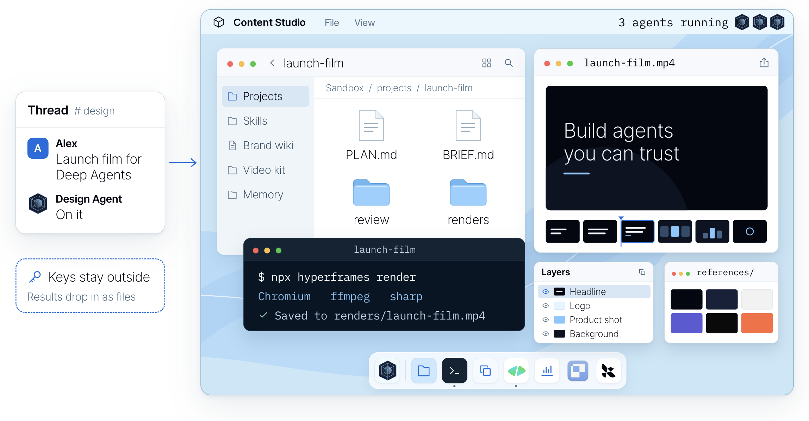

> **This fork** runs Design Agent self-hosted, behind its own web UI. Slack, the Paper canvas
> integration and the Managed Deep Agents / LangSmith-hosting deploy path were removed; the engine
> (assembly, harness, skills, gates, the Docker sandbox and the self-hosted API) is upstream's, and
> a channel UI plugs in through one presenter hook (`src/design_agent/surfaces/presenter.py`). The
> rest of this page is upstream's, trimmed to match.

## Creative House: our channels and canvas on this engine

This fork keeps Design Agent's engine as it is (the lead and its helpers, a computer per thread,
the skills, the checks, events and wake-ups, pipelines, looks, the cost meter) and replaces its
presentation stack with our own:

- **Channels instead of Slack.** A message to the agent in a channel starts a thread, and the
  thread is a task: one lead, one computer, its own project folder. Replies steer the running
  work; Stop ends the turn at its next step. Each turn shows as a card of steps in plain words,
  helpers and renders as lanes, and a footer with the time and the estimated cost.
- **Our canvas instead of Paper.** Each task is a flow of assets on the channel's canvas: what it
  started from, then each piece of work (a storyboard, a teaser, thumbnails, social cards, a GIF,
  a chart, a deck), with a line from what each is made from. The agent files work under an asset:
  its review as a board (`canvas_publish_board`), its finished files (`canvas_deliver`), where it
  stands (`canvas_update_asset`). People pin notes to a frame, ask for changes, approve a board or
  pick a look; the agent reads that back (`canvas_read_feedback`) and answers with a new version.
- **Asking for more, and templates.** From any card, people ask for one more asset made from it
  (fourteen kinds of work, each routed to the skill that makes it), or place a template: a set of
  assets wired together for a common job (Launch kit, Explainer, Post to social, Ad set, Pitch
  pack, Social pack, Talk to clips), from files, a link or notes, or from a finished asset. The
  kinds and templates live in `surfaces/web/catalog.py`; the `canvas` skill holds the workflow.
- **Self-hosted only.** SQLite (or Postgres), the in-process waker, a Docker sandbox per thread.

The surface lives in `src/design_agent/surfaces/web/` (API, live events, store, presenter
middleware, canvas tools, delivery, and a scripted demo lead); the app in `web/` (React, Vite,
TypeScript).

```bash
uv sync --all-extras --dev
uv run design-agent sandbox build                    # the agent's computer
(cd web && npm install && npm run build)             # the app
uv run python -m design_agent.surfaces.web --demo    # the scripted lead: no API keys
uv run python -m design_agent.surfaces.web           # a real model (ANTHROPIC_API_KEY in .env)
```

Then open http://127.0.0.1:8765. For app development, run `npm run dev` in `web/` (port 5178);
it passes `/api` through to the engine.

---

<div align="center">
  <p>
    <a href="https://www.langchain.com/?utm_source=github&utm_medium=readme&utm_campaign=design-agent#gh-light-mode-only"></a><a href="https://www.langchain.com/?utm_source=github&utm_medium=readme&utm_campaign=design-agent#gh-dark-mode-only"></a>
  </p>
  <picture>
    <source media="(prefers-color-scheme: dark)" srcset="https://github.com/langchain-ai/design-agent/raw/main/docs/assets/readme/header-dark.png">
    
  </picture>
  <p>
    <a href="LICENSE#gh-light-mode-only"></a><a href="LICENSE#gh-dark-mode-only"></a>
    <a href="https://www.python.org#gh-light-mode-only"></a><a href="https://www.python.org#gh-dark-mode-only"></a>
    <a href="https://github.com/langchain-ai/deepagents#gh-light-mode-only"></a><a href="https://github.com/langchain-ai/deepagents#gh-dark-mode-only"></a>
  </p>
  <p>
    <b><a href="#quickstart">Distribute Content Studio to your team →</a></b> ·
    <a href="#try-it-locally">Try it locally, no keys needed</a> ·
    <a href="https://www.langchain.com/blog/design-agent?utm_source=github&utm_medium=readme&utm_campaign=design-agent">How we built it</a> ·
    <a href="docs/README.md">Docs</a>
  </p>
</div>

**Content Studio is the design agent LangChain runs, now open source.** Add your brand and run it
for your team. Anyone can ask it like they'd ask a designer, attach what they have, and get
finished, on-brand files back, from a resized ad to a launch film.

Since August it has shipped over 3,000 assets for us, posts with its work drew about 4.5M views on
X, and three in four requests come from outside marketing. [How we built it](https://www.langchain.com/blog/design-agent?utm_source=github&utm_medium=readme&utm_campaign=design-agent) goes deeper
into each part.

## See it work

We asked Content Studio for its own launch film. It went full Rocky.

https://github.com/user-attachments/assets/ee5b98e0-7ec6-4b24-ada6-1f27087947a3

<p align="center"><sub>From a 1-bit chick to champion in 47 seconds.</sub></p>

## How it works

Content Studio is a [Deep Agents](https://github.com/langchain-ai/deepagents) agent. This repo is
the design agent and the runtime around it, self-hosted with Docker. The model makes the creative
calls, and code renders, checks and delivers.

- **A thread.** Send a brief and any files over the HTTP API or the terminal; the finished files
  come back to the thread. A channel UI shows the work as it goes and carries follow-ups in through
  the presenter hook.
- **A computer per thread.** Each thread gets its own sandbox: a Docker container with Chrome,
  FFmpeg, [HyperFrames](https://hyperframes.heygen.com), D2 and your fonts, built from one pinned
  recipe ([`sandbox/setup.sh`](sandbox/)). Everything it makes is code in a project folder there (a
  slide is HTML, a film is an animation timeline), so a change is an edit and a re-render, not a
  restart. API keys never enter it.
- **Skills and a design wiki.** The always-on prompt is small. For each ask it first reads a router
  skill that picks the right workflow, from a resized ad to a launch film, out of its
  [skills](skills/). The wiki holds the craft (type, colour, layout, charts) and your brand pack
  holds the facts. Skills load only when a job needs them.
- **Your tools.** Video is built in HyperFrames, which treats a film as a web page on a timeline.
  Image, voice and music models run as tools outside the sandbox, and MCP servers connect with
  credentials from the host ([Integrations](docs/integrations.md)).
- **Async subagents.** On a big job the main agent plans, splits the work and starts subagents in
  the background on the same sandbox and files. It is woken when one finishes, fails or stalls, so
  it never sits waiting and can keep talking to you. Films go storyboard, animatic, then
  production, and code makes every part pass review before assembly.
- **It gets better.** After a job, `learn_from_job` writes notes on what worked against the skill
  it used. Later jobs read and rate those notes, and the ones that don't hold up are dropped.

### Watch it explain itself

We asked it to explain its own harness as a nature documentary, starring a pixel parrot. It walks
through the computer, the tools and the context behind its work.

https://github.com/user-attachments/assets/65eac8e4-0fac-4a5a-9cca-02e26a0a8baa

<p align="center"><sub>Storyboarded, built and narrated by the agent, in one thread.</sub></p>

<details>
<summary>The prompt that made this film</summary>

The agent made it from this ask and a few rounds of notes:

> Make a short explainer of how you create videos in code, end to end, for our blog post on the
> media harness we built on Deep Agents. Narrate it like a David Attenborough nature documentary,
> starring the pixel parrot from our promo, with your subagents as its flock. Keep it technical
> enough for an engineer, in real terms: skills, wiki, tools, apps. Storyboard it before you build,
> and end on "Built on Managed Deep Agents".

</details>

Read the [architecture](docs/architecture/README.md), or start changing it:
[instructions.md](instructions.md) · [skills/](skills/) · [Customization](docs/customization.md) ·
[Evals](docs/evals.md) · [Operations](OPERATIONS.md) · [Contributing](CONTRIBUTING.md).

## Why it doesn't look like AI

<p align="center">
  <picture>
    <source media="(prefers-color-scheme: dark)" srcset="https://github.com/langchain-ai/design-agent/raw/main/docs/assets/readme/same-prompt-dark.png">
    
  </picture>
</p>

<p align="center"><sub>The same prompt to a local coding agent with a brand skill, and to Content Studio.</sub></p>

- **It looks at its work.** It renders, then looks at the image before it posts anything.
- **Your brand is code.** Layouts only take your tokens: your colours, fonts and spacing.
- **It checks what a machine can count.** Colours, fonts, contrast, sizes and chart math are checked
  in code on every render. Taste stays with your designers.

<p align="center">
  
</p>

## Quickstart

Run it for your team on a machine with Docker (Compose v2.24+) and a model key:

```bash
git clone <this repository> design-agent && cd design-agent
uv sync
uv run design-agent config set ANTHROPIC_API_KEY=sk-ant-…
uv run design-agent config generate DESIGN_AGENT_API_TOKENS POSTGRES_PASSWORD
docker compose -f deploy/self-host/compose.yaml up -d --build
```

[Self-hosting](docs/self-hosting.md) covers the API, persistence and checking it works.

**Or ask your coding agent.** Open the repo in Claude Code, Codex or Cursor and say what you want.
[AGENTS.md](AGENTS.md) routes each request to a step-by-step [skill](.agents/skills/):

| Say | It will |
| --- | --- |
| "Run it for our team." | set it up self-hosted and check it with a real request after your yes |
| "Build our brand pack from our website and brand guide." | draft the pack, validate it, and ask you to review it |
| "Teach it to make our weekly newsletter header." | add a skill for it and try it on a real request |
| "Did that change make it better?" | run the evals before and after, and show you the numbers |

## Try it locally

The demo runs the real agent, sandbox and checks with a scripted model and no API keys. It needs
**Docker**, and leaves a launch card in three sizes and a 4-second teaser in `workspace/out/demo/`:

```bash
uv run design-agent sandbox build
uv run design-agent demo
```

With a model key in `.env`, ask for something real. Files land in `workspace/out/<thread>/`, and the
last line tells you what the run cost:

```bash
uv run design-agent ask "A LinkedIn card announcing our design review service, 1200x627."
```

## Make it yours

This repo has two kinds of skills. The ones in [`.agents/skills/`](.agents/skills/) are for your
coding agent, to set up, brand, deploy and change this repo. The ones in [`skills/`](skills/) are
what Content Studio reads while it works. [Customization](docs/customization.md) covers both.

| Want | Add | Guide |
| --- | --- | --- |
| Your brand | `workspace/brand/` (until then, a neutral sample brand) | [brand-onboarding skill](.agents/skills/brand-onboarding/SKILL.md) |
| Generated images | `OPENAI_API_KEY`, or the LangSmith Gateway | [Models](docs/models.md) |
| Voice, music, sound effects | `ELEVENLABS_API_KEY` | [sound skill](skills/sound/SKILL.md) |
| Web search, your docs, other tools | MCP servers in `config/mcp.toml` | [Customization](docs/customization.md) |

Once it's yours, ask it like you'd ask a designer:

- "A launch card for our new feature, in LinkedIn, X and Instagram sizes."
- "A Rocky-themed promo film for our launch, with music and sound effects."
- "A chart of our weekly signups from this CSV." (attach the file)
- "A YouTube thumbnail for this video."
- "Caption this webinar clip." (attach the clip)

Everything on this page uses LangChain's brand, because that's the one we run. Licensed fonts go in
`private-fonts/`, which Git ignores.

## Questions

**What does it cost?** The code is free (Apache 2.0). You pay your model provider: at LangChain the
median request costs about 50 cents in model spend, and long films and decks cost more.

**Will it use my brand?** Yes. Add your brand pack and every file follows it. The
[brand-onboarding skill](.agents/skills/brand-onboarding/SKILL.md) builds the pack with you from
your brand guide, website or files.

**Where do I start?** With the graphic your team asks for every week. Let people brief the agent,
review the work and ask for changes in a thread, then teach it the next thing.

**Is it safe with my keys?** The sandbox never holds a credential and has no network by default.
Host tools do the fetching, generating and delivering, and drop results in as files.

**Which models?** Claude Opus 5.5 by default. OpenAI and Google models, any OpenAI-compatible
endpoint and the LangSmith Gateway work too. See [Models](docs/models.md).

**Can I run it on my own servers?** That is how this fork runs: [Self-hosting](docs/self-hosting.md)
runs the agent with Docker and an HTTP API.

**Why two names?** Content Studio is what we call the agent at LangChain. The repository, package
and command are `design-agent`.

**Does it replace a designer?** No. It takes the repetitive requests, so designers spend their time on
the work only they can do, and their judgment lives on in its skills and checks.

**Build your own.** Fork it, add your brand tokens, fonts and skills, and run it for your team.
[Quickstart](#quickstart). If it's useful, a star helps other teams find it.

## Built with

<p>
  <a href="https://github.com/langchain-ai/deepagents"> <b>Deep Agents</b></a>
  &nbsp;&nbsp;
  <a href="https://hyperframes.heygen.com"> <b>HyperFrames</b></a>
</p>

Also: [LangSmith](https://smith.langchain.com/?utm_source=github&utm_medium=readme&utm_campaign=design-agent) ·
[Chrome Headless Shell](https://developer.chrome.com/blog/chrome-headless-shell) ·
[FFmpeg](https://ffmpeg.org) · [D2](https://d2lang.com) · [Apache ECharts](https://echarts.apache.org) ·
[sharp](https://sharp.pixelplumbing.com). Logos belong to their owners. HyperFrames is a partner
project we build on.

---

[Apache 2.0](LICENSE) · [Notices](NOTICE.md) · [Changelog](CHANGELOG.md) · [Security](SECURITY.md) · [Code of conduct](CODE_OF_CONDUCT.md)
