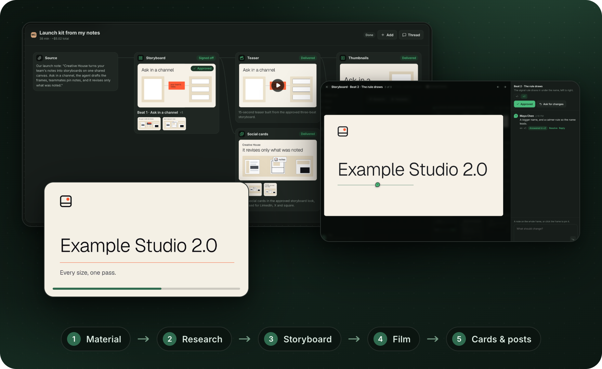
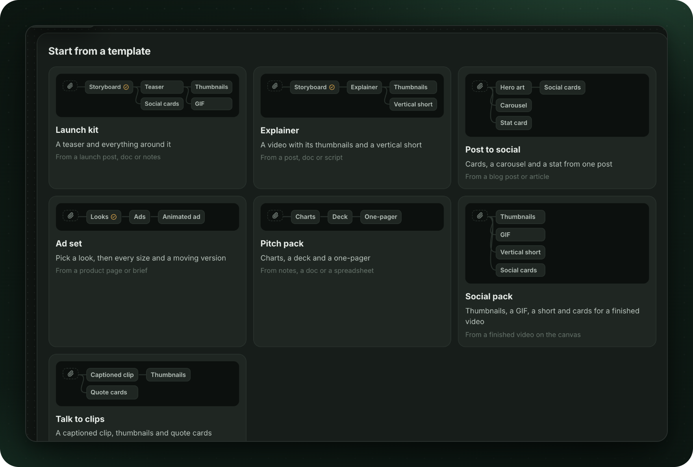
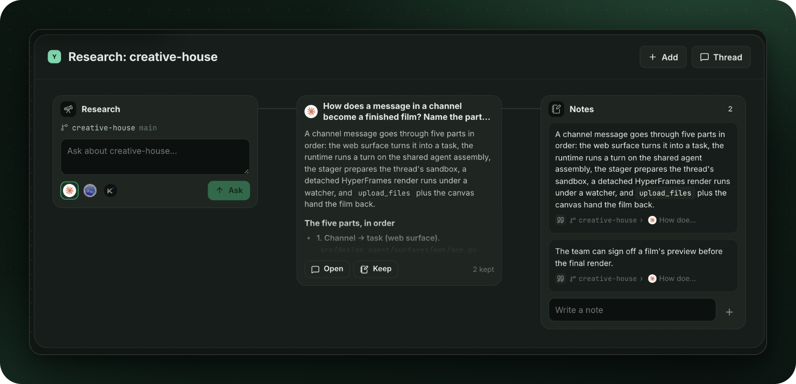
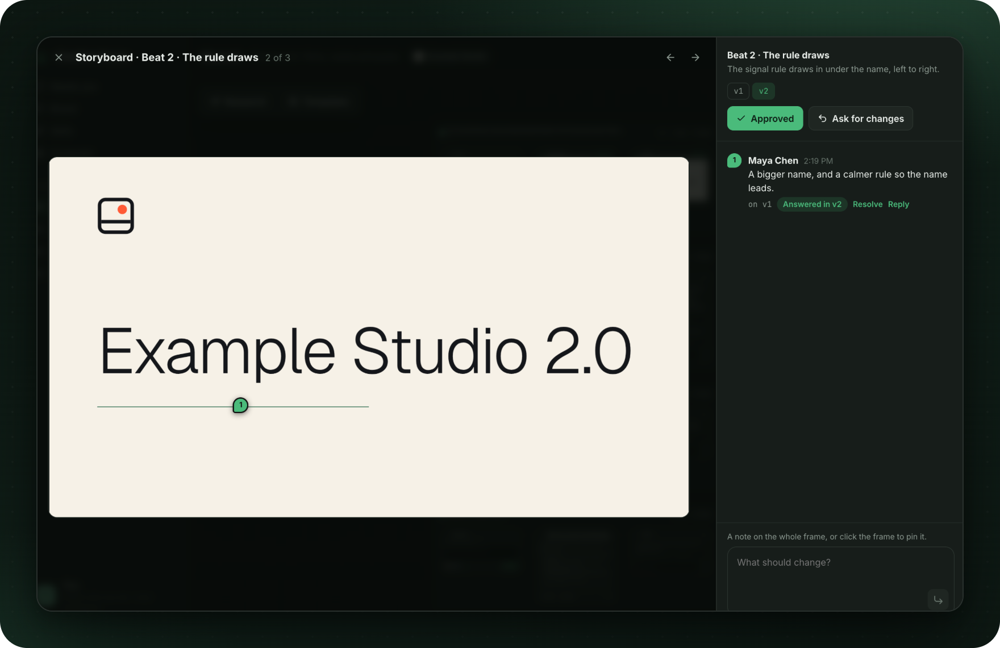
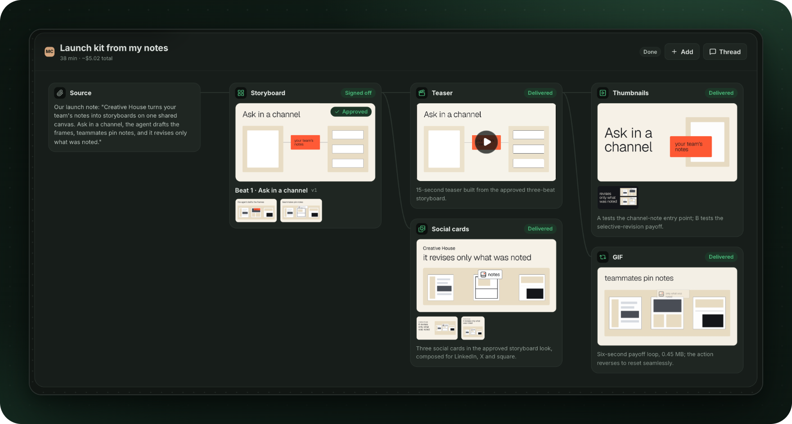
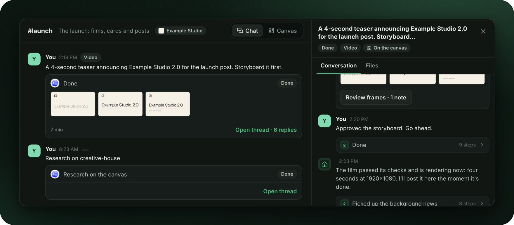
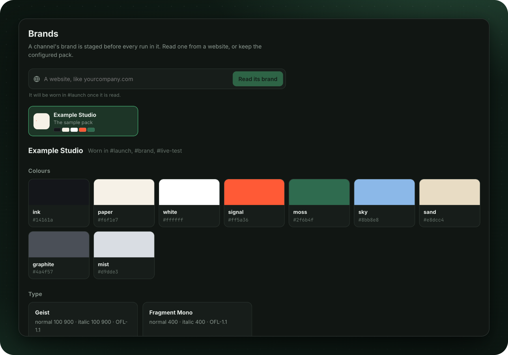

# Incredible.dev

Developer content made from the material you already have. Bring a repository, docs, a blog post,
a talk or your notes, and a team of AI agents researches it, storyboards it and makes the film, the
thumbnails, the cards and the posts, in channels you can steer and on a canvas you can review.

<p align="center">
  
</p>

> **A new beginning.** This is the new Incredible.dev. The earlier video creator lives on the
> [`archive/dev-video-creator`](https://github.com/IncredibleDevHQ/Incredible.dev/tree/archive/dev-video-creator)
> branch.

## How it flows

### 1. Start from your material

Ask in a channel and attach what you have, or place a template: Launch kit, Explainer, Post to
social, Ad set, Pitch pack, Social pack or Talk to clips.



### 2. Research your code

A research frame asks local coding agents (Claude Code, Codex, Kimi Code) about your repository.
Keep any passage of an answer as a note: each note records where it came from, and notes feed what
gets made.



### 3. Storyboard, then sign off

Films start as a storyboard. Pin a note to a frame and the next version answers it; approve when
it's right.



### 4. The film and everything around it

The film is built in code with [HyperFrames](https://hyperframes.heygen.com), then thumbnails,
social cards and GIFs, each linked on the canvas to what it was made from.



### 5. Steer it in a thread

Every task is a thread with its own lead agent and computer. Reply to steer the work, approve a
preview, or stop it.



## Your brand on everything

Read a brand from a website, or keep a brand pack, and choose which one each channel uses.



## Run it locally

You need Docker, [uv](https://docs.astral.sh/uv/) and Node.js.

```bash
uv sync --all-extras --dev
uv run design-agent sandbox build                    # the agents' computer
(cd web && npm install && npm run build)             # the app
uv run python -m design_agent.surfaces.web --demo    # a scripted lead, no API keys
uv run python -m design_agent.surfaces.web           # a real model (a provider key in .env)
```

Then open http://127.0.0.1:8765. For app development, run `npm run dev` in `web/` (port 5178); it
passes `/api` through to the server. [Models](docs/models.md) lists the providers and their keys.

To run the frontend and backend together in Docker with Supabase login and PostgreSQL, use the root
`compose.yaml`: `docker compose up -d --build --wait`. See [local Compose setup](docs/local-compose.md)
for first-time environment settings, existing data, backups and container limitations.

The Docker app uses [Supabase Auth and private workspaces](docs/supabase.md). The native
development app without Supabase configuration still uses local identity headers and SQLite;
keep that developer mode on 127.0.0.1. The Compose setup also remains localhost-only.

## How it's built

- **The agents.** Each task gets a lead agent that plans and hands work to helper agents, a Docker
  sandbox of its own, skills for each kind of work, and checks it runs on its renders (brand,
  motion, output). A cost meter tracks every run.
- **The app.** The server in `src/design_agent/surfaces/web/` (API, live events, store, canvas
  tools, research, brands) and the web app in `web/` (React, Vite, TypeScript), plugged in through
  one presenter hook, `src/design_agent/surfaces/presenter.py`.

More: [architecture](docs/architecture/README.md) · [instructions.md](instructions.md) ·
[skills/](skills/) · [customization](docs/customization.md) · [changelog](CHANGELOG.md).

## License

[Apache 2.0](LICENSE). Third-party notices are in [NOTICE.md](NOTICE.md).
